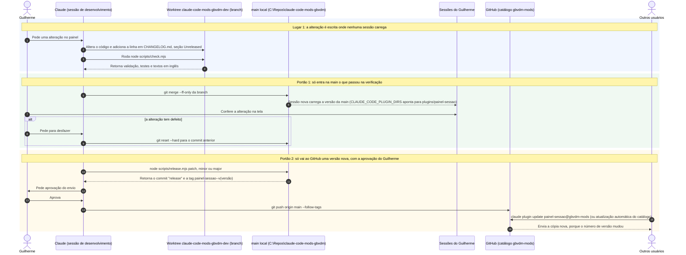

# Diagramas do repositório claude-code-mods-gbvdm

Diagramas de sequência do processo do repositório. Abra na pré-visualização do VS Code (`Ctrl+Shift+V`). Os diagramas da lógica do painel ficam em `plugins/painel-sessao/.diagramas.md`.

---

## 1. Da alteração à publicação: três lugares e dois portões

> **De onde:** `CONTRIBUTING.md` (o processo escrito), `scripts/check.mjs` (valida o catálogo e cada plugin, roda os testes e confere que todo texto em português tem versão em inglês) e `scripts/release.mjs` (aumenta o número de versão em `plugin.json`, data a seção `Unreleased` do `CHANGELOG.md`, cria o commit e a tag na `main`; não envia ao GitHub). 
> **Conferido em 14/10/2026:** os dois scripts rodaram numa cópia descartável do repositório (versão 0.2.0 passou a 0.2.1, com a tag `painel-sessao--v0.2.1`; um texto sem versão em inglês fez a verificação falhar). **Não conferido:** se uma sessão já aberta recarrega o painel sozinha quando a `main` muda. Sessão nova carrega a versão da `main`.

**Limites que o diagrama não mostra:**

- Um envio ao GitHub sem número de versão novo não chega a ninguém: o Claude Code de quem instalou guarda a cópia que tem até o número mudar.
- O notebook está fora do processo por decisão do Guilherme (14/10/2026). Como o `settings.json` sincroniza, lá o `CLAUDE_CODE_PLUGIN_DIRS` aponta para uma pasta que não existe, e o painel não carrega.

---

## Histórico de Alterações

| Data | Autor | Alteração |
|---|---|---|
| 2026-10-14 | Claude | Criado com o diagrama 1 |
