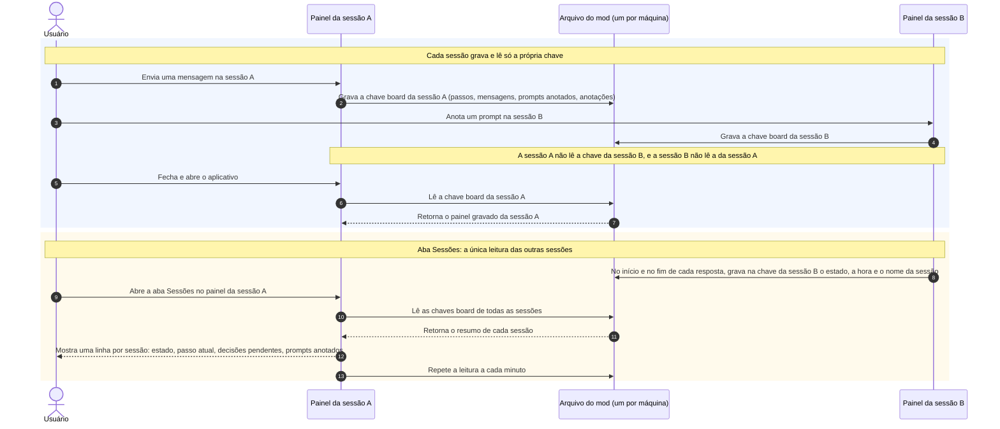

# Diagramas — mod painel-sessao

Diagramas de sequência do painel da sessão. Abra na pré-visualização do VS Code (`Ctrl+Shift+V`).

---

## 1. O painel é por sessão; só a aba "Sessões" lê as outras

> **De onde:** `hooks/register.tsx`, as funções `commit` (grava o painel da sessão no arquivo do mod), `restore` (lê o painel gravado quando a sessão reinicia), `prune` (exclui o que ficou 30 dias sem gravação) e, desde 07/10/2026, `sessionRows` (lê o resumo de todas as sessões para a aba "Sessões").<br>
> **Conferido na tela em:** a primeira metade, em 02/10 e 06/10/2026, com uma sessão só. A aba "Sessões" **não foi conferida na tela**: só em teste automático, com sessões simuladas. Duas sessões com o mod ao mesmo tempo **não foram conferidas**.

**O que este diagrama responde:** o que cada sessão grava, o que ela lê, e como uma sessão mostra o estado das outras.



**Limites que o diagrama não mostra:**

- O arquivo do mod fica em `~/.claude/plugins/store/`, na máquina do usuário. A aba Sessões mostra só as sessões da mesma máquina.
- Uma sessão sem o mod carregado não grava nada, então não aparece na aba Sessões.
- A aba Sessões só lê. Ela não envia prompt nem altera o painel de outra sessão.

---

## 2. Envio automático: quando o prompt entra, quando aguarda e quando repete o envio

> **De onde:** `hooks/register.tsx`, as funções `arm` (inicia a espera de 5 segundos quando o envio automático está ligado, existe prompt anotado e nenhuma resposta está em curso), `fire` (ao fim dos 5 segundos, envia o primeiro prompt anotado), `held` (verifica se a pesquisa do aplicativo está na tela ou se um agente está em execução), `unstick` (um prompt enviado que não entrou na conversa em 2 minutos fica anotado de novo) e `dispatch` (envia o prompt como mensagem do usuário e retorna se ele entrou).<br>
> **Conferido na tela em:** nada deste diagrama foi conferido na tela. Os 12 testes cujo nome começa com "automatic sending" e o teste "a prompt sent that starts no turn is noted again" cobrem cada trecho com relógio simulado.

**O que este diagrama responde:** por que o envio automático parava depois da pesquisa do aplicativo, e o que mudou em 07/10/2026.

```mermaid
sequenceDiagram
    autonumber
    actor U as Usuário
    participant P as Painel (mod)
    participant C as Claude Code
    participant A as Aplicativo desktop

    rect rgba(138, 180, 248, 0.12)
    Note over U,A: Caminho normal
    C->>P: Fim da resposta (turn.complete, motivo "answer")
    P->>P: arm: envio ligado, prompt anotado, nenhuma resposta em curso
    P-->>U: Mostra "O primeiro prompt entra às HH:MM:SS" e o botão Cancelar
    P->>P: Aguarda 5 segundos
    P->>C: fire chama dispatch, que envia o primeiro prompt anotado
    C-->>P: O prompt entrou; o painel exclui o prompt da lista
    end

    rect rgba(253, 214, 99, 0.12)
    Note over U,A: Antes de 07/10: uma falha encerrava a fila
    A-->>U: Mostra a pesquisa sobre a sessão
    P->>C: dispatch envia o prompt
    C-->>P: O prompt não entra
    Note over P: Nada chamava arm de novo sem um novo fim de resposta
    end

    rect rgba(129, 201, 149, 0.12)
    Note over U,A: Desde 07/10
    A->>P: Desenha a faixa acima do prompt com hasSurvey verdadeiro
    P->>P: held retorna "pesquisa": arm não inicia a espera
    P-->>U: Mostra "Aguardando a pesquisa do aplicativo sair da tela para enviar"
    U->>A: Responde ou fecha a pesquisa
    A->>P: Desenha a faixa com hasSurvey falso
    P->>P: arm inicia a espera de 5 segundos
    loop A cada 15 segundos, com a sessão sem resposta em curso
        P->>P: unstick e depois arm
    end
    P->>C: dispatch envia o prompt
    alt o prompt não entra 3 vezes seguidas
        P-->>U: Desliga o envio e mostra "Desligado às HH:MM: o prompt não entrou na conversa em 3 tentativas"
    else a resposta é interrompida ou termina com erro
        P-->>U: Desliga o envio e mostra o motivo no painel
    end
    end
```

**Limites que o diagrama não mostra:**

- A pesquisa do aplicativo bloqueia o envio por 3 minutos no máximo. Depois disso o prompt é enviado mesmo com `hasSurvey` verdadeiro, porque a faixa pode não ser desenhada de novo quando a pesquisa sai.
- Não foi medido o que `$.prompt.submit` retorna com a pesquisa na tela. O painel cobre os dois casos: o envio que falha e o envio que fica sem resposta.
- Ligar o envio automático com a conversa parada inicia a espera de 5 segundos na hora, sem aguardar uma resposta.

---

## 3. Campo de texto: por que o texto sumia e o cursor pulava

> **De onde:** no mod, `hooks/register.tsx`: `fieldSet` (guarda o valor que o mod quer no campo depois de Enter ou ao alterar uma anotação), `fieldValue` (decide o valor desenhado no campo) e `typedIn` (exclui o valor guardado quando o usuário digita). No aplicativo desktop (versão 2.26454.0): antes de trocar os elementos do painel, o aplicativo lê o texto de cada campo, e grava o texto de volta depois quando o valor desenhado não mudou.<br>
> **Conferido na tela em:** não conferido na tela. A regra do aplicativo foi lida no código dele em 07/10/2026; o comportamento do mod está coberto por 3 testes.

```mermaid
sequenceDiagram
    autonumber
    actor U as Usuário
    participant A as Aplicativo desktop
    participant P as Painel (mod)

    rect rgba(242, 139, 130, 0.12)
    Note over U,P: Antes de 07/10: o mod desenhava no campo o texto digitado até aquele instante
    U->>A: Digita "abc"
    A->>P: Envia cada alteração do campo
    P->>A: Redesenho por outro motivo, com valor "ab" (o que o mod tinha recebido)
    A->>A: Troca todos os elementos; valor desenhado mudou, então grava "ab" no campo
    A-->>U: Mostra "ab": a letra "c" some e o cursor muda de lugar
    end

    rect rgba(129, 201, 149, 0.12)
    Note over U,P: Desde 07/10: enquanto o usuário digita, o mod não desenha valor
    U->>A: Digita "abc"
    P->>A: Redesenho por outro motivo, sem valor no campo
    A->>A: Troca todos os elementos e grava de volta "abc", com o foco e a posição do cursor
    U->>A: Tecla Enter
    A->>P: Envia "abc"
    P->>A: Redesenho com valor vazio (o valor desenhado mudou)
    A-->>U: Mostra o campo vazio
    end
```

---

## Histórico de Alterações

| Data | Autor | Alteração |
|---|---|---|
| 2026-10-06 | Claude | Criado com o diagrama 1 |
| 2026-10-07 | Claude | Diagramas 2 (envio automático) e 3 (campo de texto) |
